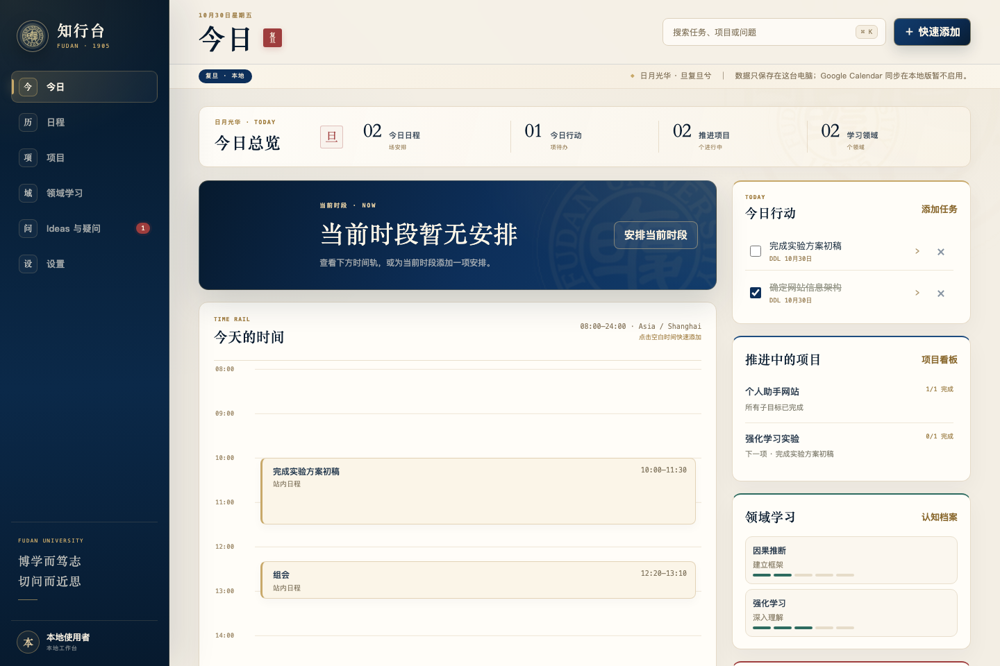

# 复旦 · 桌面 / Fudan · Desktop

| 校园 | 晨光 | 秋色 |
| --- | --- | --- |
|  |  |  |
| **晚霞** | **暮色** | **月夜** |
|  |  |  |

一个 DeepSeek Harness Web UI 插件，主要提供三件事：

1. **可拖动的复旦风格额度 + 天气状态卡** —— 深蓝金边卡片，左侧是校徽徽章，中间是余额、今日消耗与 24 小时走势，下方是一条天气带：当前温度、天气、下一次降雨和校区。按住卡片可拖到任意位置，位置会记住；看板头部的准星按钮可重置回右下角。点开是一张同样风格的看板：余额、充值 / 赠送构成、今日 / 日均 / 预计可用、峰谷倒计时、体感 / 湿度 / 降雨详情，附校训「博学而笃志，切问而近思」。
2. **全屏壁纸** —— 6 张精选复旦校园水彩：**校园、晨光、秋色、晚霞、暮色、月夜**。原来的极光、深海、晨雾、樱粉、星夜、薄荷、暮色渐变、墨白和光华楼线稿等普通预设已全部移除。也支持图片链接或本地图片，可在独立设置页里实时调整不透明度、模糊、暗化遮罩与适配方式（铺满 / 完整显示）。
3. **知行台（本地）** —— 侧栏新增「知行台」：把今日、日程、项目、领域学习、Ideas 与疑问放进插件内的一个独立工作台。它复用你原来的 Personal Workflow UI，但完全本地运行：不需要 ChatGPT/Sites 登录，不使用 Cloudflare D1，所有数据只写入本机 DSH profile；Google Calendar 同步在本地版暂不启用。

## 壁纸库（六张）

六张图全部是同一组复旦校园水彩，原图由项目作者提供，尺寸均为 1672 × 941；插件内嵌同图 WebP：

1. **复旦 · 校园** —— 日间，光华楼、校门、石桥与樱花；默认壁纸。
2. **复旦 · 晨光** —— 清晨薄雾里的校园与花枝。
3. **复旦 · 秋色** —— 金黄银杏与「复旦大学」校门。
4. **复旦 · 晚霞** —— 火烧云、亮灯的光华楼与湖面倒影。
5. **复旦 · 暮色** —— 蓝调暮色里的校园与暖灯。
6. **复旦 · 月夜** —— 满月、星夜、亮灯的复旦校园与校徽石。

首次加载这个版本会自动切换到「复旦 · 校园」一次；其余五张都是可选壁纸，不会自动切换。选中「校园 / 晨光 / 秋色」时若当前遮罩高于 30% 会降到 22%；「晚霞 / 暮色」降到 18%；「月夜」降到 16%。

壁纸版权归提供者；插件代码使用 MIT，壁纸本身不包含在 MIT 授权中。校徽为复旦大学商标，仅作个人识别。市场截图在 `screenshots.json` 中排列：前两张是知行台界面，后六张是壁纸。

## 知行台（本地）

侧栏的 **知行台** 是原 `personal-workflow` 的本地化版本，入口在插件内，不是外链：



> 截图摄于加入「课表」之前；课表与提醒目前只有代码与测试，还没有重拍的市场截图。

- **Fudan Editorial UI**：深蓝校徽侧栏、宣纸色画布、宋体标题、香槟金细线、朱红「复旦」印章与校训；今日页是一条 bento 式总览指标带，下面是主时间轨 + 右侧行动/项目/领域栏。日历、项目、学习、Ideas 和设置共用同一套纸感卡片与金色分隔；页面自带官方校徽水印与「日月光华 · 旦复旦兮」。
- **课表（v2 新增）**：按「第 1 周周一 + 总周数」建立学期，课程由「星期 + 节次区间 + 周次」描述，支持单双周与分段周次（`1-8`、`1-16单`、`2,4,6`）。课表页是一张 7 × 13 的周网格，可切换周次，今天整列高亮；同一格冲突时自动并排。点空格新增一节课，点课程块编辑或删除。课程块写「课程名 + 教室 + 教师」：教室是第二行加粗的深灰字（不再做成浮起的白色标签），教师是再下面一行更淡的小字，只有一个节次的矮块不显示教师。节次由左侧行标提供，不在块内重复（v5.2）。手机上打开会自动滚到今天那一列，两侧有渐隐避免半截列；默认只显示周一到周五，周六周日这一周真有课才出现。
- **.ics 导入（v5.1 新增）**：把课表文件拖进课表页就能自动排好——在本地解析，不上传。它会按事件最早的那一周推出「第 1 周周一」，把逐个节次的事件合并成「第 3–5 节」这样的区间，把周次收成 `1-16`，并按事件时间同步修正作息表。支持旦挞（DanXi）导出的 `timetable.ics`（一个节次一个 VEVENT，时间是 UTC）以及带 `RRULE:FREQ=WEEKLY` 的日历导出。如果本地作息表和文件对不上（例如从旧版本升上来），对不上的时间会按相邻节次归位，并用文件里的真实时间修正作息表，不会静默丢课。首次进来是示例课表时，导入前会提示「先清空示例课表」，勾选后会删掉示例学期再按你的文件重建。
- **今日页（v2 重做）**：总览指标改为「今日课程 / 今日行动 / 本周 DDL / 推进项目」；新增今日课程条带；时间轨把当天的课程、日程与定时任务合并到同一条 08:00–24:00 的轨道上；右栏新增「临近 DDL」。
- **重叠合并（v5.3）**：时间轨上两个块重叠时合成一个块，用一条对角线切成两半，各占一半面积：早的在上半、晚的在下半，各自保留标题、教室/来源与时间。重叠不足 75 分钟的窄块、以及三个以上的重叠仍退回并排分栏，避免两半都读不清。
- **提醒（v2 新增）**：每日摘要（当天第一次打开、且过了设定时间）与 DDL 提前提醒（默认 24/2 小时，可开关），在页面内以 toast 呈现；浏览器授权后同时发系统通知。顶栏铃铛汇总今天课程与未来 7 天 DDL。
- **个人画像（v2 起步）**：默认是空的，只保留一个 `FDUer` 称呼，可在设置页改；画像声明（作息、偏好、擅长科目）留给下一版，数据结构已经预留 `profile.claims`。
- **周历回顾**：日程页支持「← 上一周 / 本周 / 下一周 →」，从周一开始显示完整一周；时间轨顶部留白，08:00 标签不会被卡片或粘性表头遮住。
- **截图**：`assets/workflow-today.png`、`assets/workflow-calendar.png`（1440 × 960）；`assets/workflow-mobile.png`（390 × 844）。市场展示也把前两张放在最前面。

- **本地数据**：`~/.dsh/profiles/<profile>/data/dsh-fudan-workflow/workspace.json`（macOS 实际路径由 `DSH_PROFILE_DIR` 决定），权限 `0600`。每个使用者、每个 DSH profile 各自一份，不经过任何远端服务。
- **作息表**：默认 13 节。第 1–7 节按旦挞导出的 2026 秋季课表校准（08:00 起，第 5 节 11:45–12:30，午休后 13:30 继续）；第 8–13 节是常见排布。导入 `.ics` 时会用文件里的真实时间覆盖对应节次。
- **数据结构版本**：文件里的 `version` 现在是 `2`。旧的 `version: 1` 文件会在首次读取时自动补齐 `profile / settings / semesters / courses / courseSlots`（不删旧数据，也不写入示例课表），然后原子写回。
- **首次启动**：会写入一组示例数据，方便先看界面；之后所有增删改都写回上面的 JSON。线上 D1 里的旧数据不会自动迁移；需要时可用 `GET /api/dsh-workflow/export` 导出，或直接把 `workspace.json` 备份走。
- **示例与清空**：设置页可以「恢复示例数据」或「清空为空白工作台」；课表为空时也可以单独「载入示例课表」，它不会覆盖已有学期。
- **范围**：课表、今日、日程、项目、领域学习、Ideas 与疑问、提醒与设置的读取和增删改；回顾模块仍按原项目保持停用。
- **不启用**：ChatGPT/Sites 登录、Cloudflare D1、Google Calendar OAuth 与同步。页面里的 Google 区域会显示为本地版未配置。
- **本机访问**：页面与 API 都沿用额度接口的本机 fence（回环 / 监听地址、同源 Origin、拒绝跨站标记）；不会因为插件安装而暴露到公网。
- **升级后需要重启 DSH**：本地工作台的 Host 路由随 DSH 启动注册。只刷新网页不够，退出并重新打开 DSH 后，侧栏的知行台才会加载；页面会显示「需要重启 DSH」的提示和重试按钮。
- **源码与构建**：`workflow-src/` 是可读的 React 源码（来自 `personal-workflow`），`workflow-dist/` 是已经构建好的离线 bundle；安装插件不需要 Node、pnpm 或额外依赖。

## 画像 · Agent · 每日简报（v5.5）

### 个人画像

长期记忆存成 `profile.claims[]`，每条带 `kind`（事实/偏好/习惯/约束）、`source`（用户/推导/导入）、`evidence`、`confidence`、`confirmations` 与状态。

- 你可以在设置页手动添加；说「记住我晚上十点后效率更高」时，agent 会调 `workflow_remember` 写一条。
- 夜间总结会从当天数据里提取候选（最多 3 条、需要有证据），习惯/偏好类先以「待确认」写入，连续确认三次转正；事实类必须你手动确认。
- 重复的 claim 会合并计数而不是堆两条；超过 120 条时先淘汰最旧的「待确认」。
- agent 每次排日程前都会读一次画像（`workflow_get_profile`），避免把事排到你明确不想要的时间。
- **重建画像**：设置页的「用最近 90 天重建」会把最近三个月的任务、日程、学习记录、笔记、Ideas、项目和最近几份简报，连同现有词条一起交给模型，产出一段画像摘要（`profile.summary`，≤400 字）和最多 12 条新词条。新词条一律先进「待确认」，被新词条取代的旧词条会退役；没有可用模型时接口返回 503 并说明原因。也可以让 agent 直接调 `workflow_rebuild_profile`。

### Agent 工具

插件往 DSH 注册了 8 个工具，直接对话就能用（不需要配 MCP）：

| 工具 | 作用 |
|---|---|
| `workflow_day_overview` | 某天的课程/任务/日程/DDL |
| `workflow_week_overview` | 某一周的课表与周次 |
| `workflow_search` | 搜任务/项目/Ideas，避免重复创建 |
| `workflow_get_profile` | 读画像 |
| `workflow_propose_schedule` | 写一批草稿（任务/日程/课程时间），返回冲突 |
| `workflow_apply_draft` | 你同意后落库 |
| `workflow_update_task` | 勾完成、改期 |
| `workflow_remember` | 写入画像 |
| `workflow_run_digest` | 立刻生成简报 |
| `workflow_rebuild_profile` | 用最近 90 天重建画像摘要与词条 |

**写入一律先草稿**：`propose_schedule` 只产生待确认条目，今日页会出现「N 批改动等你确认」，点开逐条看、确认后才落库，也可以整批放弃。工具不接受自然语言时间——模型负责把「下周三下午三点」解析成带 `+08:00` 的 ISO 字符串，工具只做校验和冲突检测。

### 每日简报

- 默认 22:30 生成，可改时间与星期；DSH 没开着就错过，**下一次启动会补跑**（没有常驻进程，这是插件能做到的边界）。
- 内容：昨日完成/未完成、今日任务与课程、未来 3 天 DDL、天气（Open-Meteo，复旦邯郸校区）。先调一次 `ctx.llm`（默认 `deepseek-flash`）生成自然语言，失败就退回本地模板，保证一定有内容。
- 今日页顶部展示「今日简报」卡片，可手动重新生成；设置页能换模型、改时间、关掉。
- **不存任何 API key**：模型调用走 DSH 的 LLM 服务，用的是这个用户在 DSH 里配置的 provider 与额度，天然一人一份。

### 与 AI 相关的本地文件

`profile.claims`、`drafts`、`digests` 仍然写在 `workspace.json` 里（v3），没有额外的云调用；唯一的外发是那一次模型请求，内容是你自己的日程摘要。

### 课表相关接口

`.ics` 导入完全在前端完成：解析 → 预览（可逐门取消）→ 复用 `semester / courseSlot` 与 `settings.periodTimes` 写入，没有新增上传接口。

`workflow-host.js` 在原有实体之外新增了三类数据，沿用同一套 `POST / PATCH / DELETE /api/dsh-workflow/workspace` 约定：

- `semester`：`name`、`startDate`（自动对齐到周一）、`weekCount`、`isActive`。
- `course`：`name`、`teacher`、`color`、`credits`、`semesterId`。
- `courseSlot`：`courseId` 或 `courseName`（同名复用同一门课）、`weekday`（1–7）、`startPeriod` / `endPeriod`（1–13）、`weeks`（`"1-16单"` 或数组）、`location`。

另有 `PATCH /api/dsh-workflow/profile`、`PATCH /api/dsh-workflow/settings`、`POST /api/dsh-workflow/timetable/demo`、`POST /api/dsh-workflow/store/reset`（`{"mode":"empty"|"demo"}`）。删除最后一节课时，课程行会一起清理；删除学期会连带它的课程与时间。

## 设计说明

状态卡以校徽为视觉锚点，并提取复旦的视觉语汇：

- **复旦蓝** `#0c2f5e → #071a33` 的深蓝渐变，配香槟金 `#c8a96a` 细边与象牙白 `#f4eedf` 文字。
- **校徽徽章**：状态卡左侧、设置页 Hero 与侧栏使用白底金环的校徽徽章；徽章图取自学校公开校徽，版权归复旦大学，插件自身图标仍为原创。
- **校训**：看板底部以宋体小字排「博学而笃志，切问而近思」，两侧渐隐金线。
- **校园视觉**：状态卡与设置页以校徽为锚点；壁纸画面本身带校徽水印、复旦校门、光华楼双塔与石桥。
- **细节**：余额数字用等宽数字；右上 24 小时余额走势；下方天气带用日轮 / 月牙、云雨图标；高峰用日轮点、空闲用月牙点；刷新时底部有一条金色扫描线；悬停时卡片轻抬、徽章微亮。

## 天气

天气来自 [Open-Meteo](https://open-meteo.com/)（免 Key），定位固定为复旦大学邯郸校区（31.2989, 121.5033），每 15 分钟刷新。卡片显示当前温度、天气现象，以及未来 24 小时内下一次降雨的时间与概率；没有降雨时显示「24 小时内无雨」。天气请求直接从浏览器发往 Open-Meteo，不经过 DSH Host。

## 拖动

按住右下角状态卡拖动即可移动；松开后位置保存在浏览器 `localStorage`，刷新、重启后保持。窗口缩小或换屏时位置会自动夹回可视范围。打开看板后，标题栏右侧的准星按钮「重置位置」会把卡片放回默认右下角。

## 设置页

点击左侧栏的「额度与壁纸」图标即可进入设置页；也可以点右下角状态卡里的「打开面板」。壁纸设置只保存在当前浏览器的 `localStorage` 里，图片不会上传到任何服务器（自定义链接除外，由浏览器直接加载）。

## 额度数据

Host 半注册 `GET /api/dsh-quota/summary`，通过凭证服务读取 `DEEPSEEK_API_KEY`，请求 DeepSeek 官方 `/user/balance`。API Key、其来源和上游错误原文都不会返回给浏览器。路由只接受本机请求（回环 / 监听地址、同源 Origin、拒绝跨站标记）。

峰谷时段按官方口径（北京时间，周一至周五 9:00–12:00、14:00–18:00 为高峰，周末和法定节假日全天空闲）。内置价格表是官方价格页的快照，调价时需要随插件版本更新；当前模型不在表中时不显示单价。

`DEEPSEEK_BASE_URL` 环境变量可覆盖余额接口地址，与 DSH 的 DeepSeek 适配器保持一致。

## 安装

```bash
dsh plugin --profile <profile> add https://github.com/zzzzym7018/dsh-fudan-status-wallpaper
```

或在 Plugins 页面安装这个仓库。安装/升级后请**退出并重新打开 DSH**（本地工作台的 Host 路由随启动注册），再刷新 Web UI；右下角状态卡、壁纸和侧栏「知行台」都会出现。

## 说明

本插件为个人作品，并非复旦大学官方插件。插件图标、日轮 / 地平线图形与光华楼线稿为原创；状态卡与侧栏中的校徽徽章取自学校公开图片（见下）。「复旦」「1905」「日月光华，旦复旦兮」「博学而笃志，切问而近思」仅作为校园文化元素引用。

## 校徽

状态卡左侧的校徽图案取自复旦大学官网公开的校徽图片，版权与商标归复旦大学所有，仅用于个人识别与校园文化表达；本插件不是复旦大学官方插件。插件自身的图标（`icon.svg`）仍为原创。
